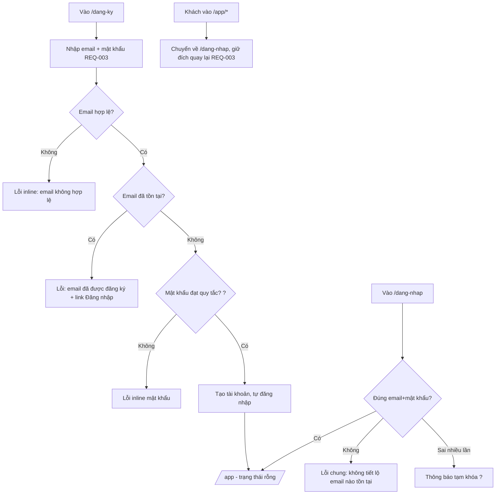
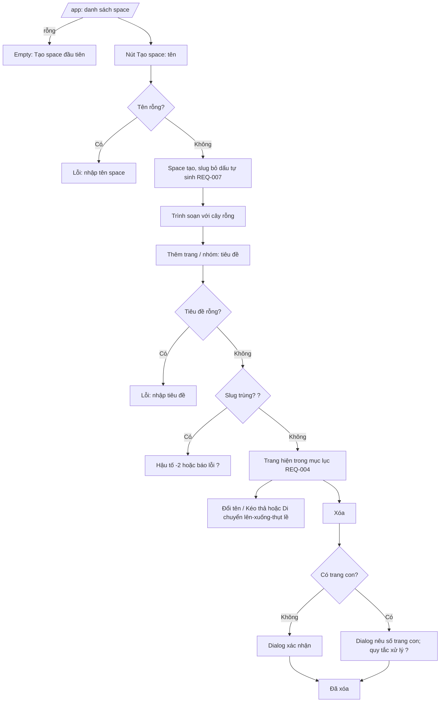
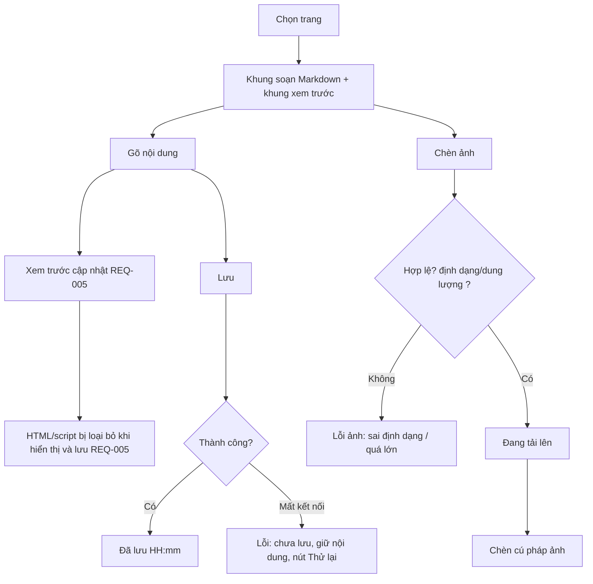
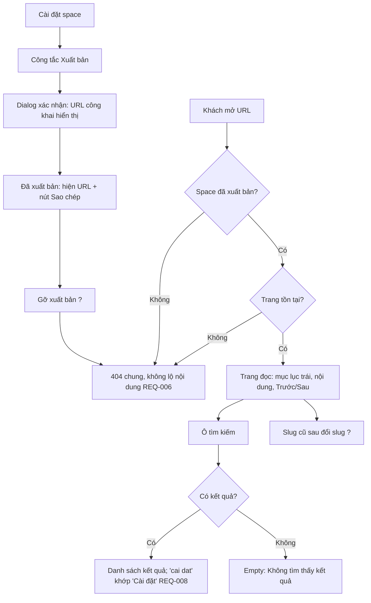

# UX flows - vn-docs-platform (Đợt 1: REQ-003..008)
Ngôn ngữ UI: tiếng Việt (REQ-002, REQ-007). Không gồm đợt 2/3. Mục "[?]" = chờ BA (xem OPEN_QUESTIONS trong handoff).

## 1. Information architecture
| Khu vực | Route (đề xuất) | Truy cập | REQ |
|---|---|---|---|
| Đăng ký | /dang-ky | Khách | 003 |
| Đăng nhập | /dang-nhap | Khách | 003 |
| Danh sách space | /app | Đã đăng nhập | 003, 004 |
| Trình soạn space | /app/{space}/{page-slug} | Chủ space | 004, 005, 006 |
| Cài đặt space (tên, slug, xuất bản) | /app/{space}/cai-dat | Chủ space | 004, 006 |
| Trang đọc công khai | /{space-slug}/{page-slug} | Mọi người | 006, 007, 008 |
| 404 | mọi URL không hợp lệ/chưa xuất bản | Mọi người | 006 |

## 2. Đăng ký / đăng nhập (REQ-003)

## 3. Space và cây trang (REQ-004, REQ-007)

## 4. Soạn Markdown + xem trước (REQ-005)

Rời trang khi có thay đổi chưa lưu: hộp xác nhận (beforeunload + dialog nội bộ).

## 5. Xuất bản và đọc công khai (REQ-006, 007, 008)

